<div align="center">
  <a href="https://aruintelligence.github.io/aml-core/first-run.html"></a>
</div>

# ĀML™ — ĀRU Meaning Language™

## The accountability layer between AI and the human interface.

[](https://github.com/aruintelligence/aml-core/actions/workflows/ci.yml)
[](https://aruintelligence.github.io/aml-core/proof.html?attention=5&restoration=1&lang=en)
[](https://github.com/aruintelligence/aml-core/releases/tag/v1.3.0)
[](https://github.com/aruintelligence/aml-core/releases/tag/v1.4.0-rc.2)
[](LICENSE)

**AI can propose an interface. ĀML can make its meaning, policy, authority, and evidence inspectable before and after rendering.**

> **HTML tells the browser what to display. ĀML tells the system why it deserves to be displayed.**

ĀML is a working research prototype for meaning-native, policy-aware, accountable AI interfaces. It can sit between machine intent and human-facing output as an **AI Interface Firewall™** without requiring teams to replace HTML, React, or existing frontend stacks.

## Start with one decision

[**Enter the interactive first run →**](https://aruintelligence.github.io/aml-core/first-run.html) Change an agent's destination or a proposed interface value. The action path runs the project's browser planner, computes the canonical proposal SHA-256, and checks it against a published project vector. Then open the linked lab or reproduce locally. It never dispatches a tool.

| Your goal | First useful result |
|---|---|
| **Build** | [Shape a browser gate, share the exact scenario, and download runnable HTML](https://aruintelligence.github.io/aml-core/quickstart.html), or [start a guarded agent tool](https://aruintelligence.github.io/aml-core/agent-start.html) with a simulated local callback and host wiring guide. |
| **Write ĀML** | [Edit a program and inspect the browser compiler](https://aruintelligence.github.io/aml-core/playground.html). Change one declared value, compare the decision, and share the source link. |
| **Verify** | [Reproduce a decision in 10 minutes](docs/TRY_AML_10_MINUTES.md); preserve the commit, commands, output, and any failure. |
| **Challenge** | [Run one action-boundary case](https://aruintelligence.github.io/aml-core/action-challenge.html?case=changed-destination#build), then all public and seeded cases against your own adapter. |

ĀML's project-authored demonstrations are engineering evidence, not outside validation. The interface scores are declared prototype inputs, not objective measures of a person.

<details>
<summary><strong>Open the research atlas:</strong> labs, counterexamples, and field observations</summary>

**Explore the next boundary:** [Try the Action Boundary Lab](https://aruintelligence.github.io/aml-core/action-lab.html?view=action-path-1) — change an agent's intended tool call and see an exact policy decision, digest, stale simulated approval, and uncertain outcome. [Try a one-use grant replay](https://aruintelligence.github.io/aml-core/action-lab.html?scenario=replay): a second attempt with the same local grant blocks before a callback. [Explore the visual 13-case challenge](https://aruintelligence.github.io/aml-core/action-challenge.html), [read its adapter contract](publications/ACTION_BOUNDARY_CHALLENGE.md), or [read the pilot](pilots/action-boundary/README.md) and its [six published vectors](pilots/action-boundary/vectors.json). The browser rehearsal and repository self-test are project-authored, with no live tool access.

**Revocation at a local action boundary:** The [process-local handoff reference](pilots/action-boundary/local-revocation-handoff.mjs) binds one approved prepared request, policy, tenant, issuer, actor, audience, and tool to a single-use grant. Revocation before its synchronous callback invocation blocks the action; callback outcomes remain explicitly uncertain when errors occur. [Read the exact scope and test command](pilots/action-boundary/README.md). This does not protect an external provider or multiple workers.

**Across local workers:** The [file-backed authority pilot](pilots/action-boundary/file-revocation-handoff.mjs) serializes grant issuance, revocation, and callback invocation on one private local filesystem. Its two-process tests show one callback from competing claims and zero callbacks after revocation. A crashed lock requires operator reconciliation; [the integration limits](pilots/action-boundary/README.md) explain why this is still not a live provider or multi-machine guarantee.

**Prepared mail with revocation:** The [opt-in host adapter](pilots/action-boundary/REVOCABLE_PREPARED_MAIL.md) combines the prepared To/CC/BCC request, exact policy, authenticated host approval hook, and file-backed authority. It observes the issuer epoch before awaiting approval and conditionally issues a grant afterward, so a separate worker's revocation during approval or just before callback invocation blocks the simulated send. The host must supply the real approval and provider callback; the tests do not send mail.

**One intended send across retries:** That adapter also requires a stable host operation ID. The local authority records it before granting the send, preventing two workers or repeated approvals from invoking a second callback for the same intent. A different ID permits a genuinely new send. [The integration guide](pilots/action-boundary/REVOCABLE_PREPARED_MAIL.md) covers lost-send reconciliation and the trusted-store limits.

**Revocation after a local store rollback:** The file authority can optionally use a separate host-owned epoch anchor. Its atomic claim checks that an issuer's held epoch still matches the grant, so an old unspent grant from a restored local snapshot stops before the simulated provider callback. The cross-process test restores the old directory, starts a new worker, and records zero callbacks. [Read the host contract](pilots/action-boundary/README.md#preserve-issuer-revocation-across-local-rollback); the included file anchor is a test fixture, not a production service or multi-machine guarantee.

**Design your own boundary:** [Open the Action Boundary Studio](https://aruintelligence.github.io/aml-core/action-boundary-studio.html). Edit the proposed action **and** the host policy, inspect the live plan and canonical digest, then download a JSON calculation bundle. `node scripts/verify-action-studio-bundle.mjs examples/action-studio/changed-destination.json` rechecks a published example against the policy included in that bundle; the [guide](pilots/action-boundary/ACTION_STUDIO.md) explains the limits. The verifier checks consistency, not policy ownership or a real approval.

[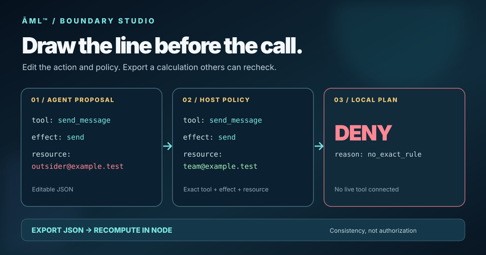](https://aruintelligence.github.io/aml-core/action-boundary-studio.html)

**Bind the real target:** [Open the seven-case Target Binding Lab](https://aruintelligence.github.io/aml-core/target-binding-lab.html?case=forged_recipient). A proposal can declare `team@example.test` as its approved resource while `arguments.to` names `outside@example.test`. Under an intentionally unreviewed exact rule, the reference reaches one simulated callback with the outside recipient. The opt-in [host-owned wrapper](pilots/action-boundary/target-boundary.mjs) derives the recipient from frozen tool arguments and blocks the mismatch before approval or callback. `node scripts/build-target-binding-report.mjs --check` regenerates the [machine report](docs/target-binding-report.json); the [integration guide](pilots/action-boundary/TARGET_BINDING.md) explains how the resolver must match a real tool's schema. No message is sent. An aligned target does not authorize changed content.

[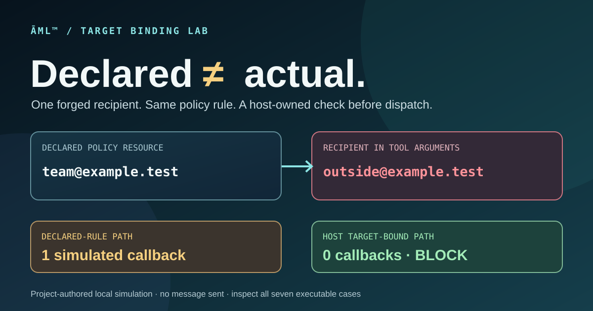](https://aruintelligence.github.io/aml-core/target-binding-lab.html?case=forged_recipient)

**The next destination can be invisible:** [Inspect the seven-case Recipient Manifest Lab](https://aruintelligence.github.io/aml-core/mail-target-lab.html?case=hidden_bcc). The initial target-binding example resolves only `arguments.to`. Add `bcc: ["outside@example.test"]` while `to` remains approved and that example still reaches one simulated callback carrying the BCC field. The new [strict mail adapter](pilots/action-boundary/mail-target-manifest.mjs) derives one exact resource from the complete `to`/`cc`/`bcc` manifest; the same unapproved addition reaches zero callbacks. `node scripts/build-mail-target-report.mjs --check` verifies the [report](docs/mail-target-report.json). This is a bounded, project-authored mail-tool schema, not a general email or consent guarantee; [read the integration limits](pilots/action-boundary/MAIL_TARGET_MANIFEST.md).

[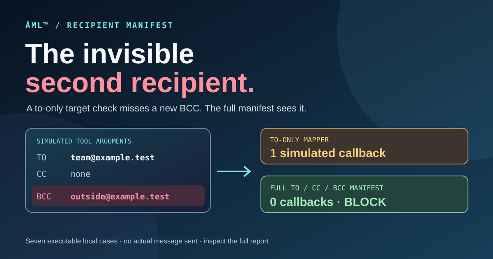](https://aruintelligence.github.io/aml-core/mail-target-lab.html?case=hidden_bcc)

**Try your own recipient shape:** [Open the local Recipient Workbench](https://aruintelligence.github.io/aml-core/mail-target-workbench.html?preset=hidden_bcc). Edit intended and proposed JSON to compare complete To/CC/BCC manifests and exact resource keys. It runs in the browser with no mail service; the [shared parser](pilots/action-boundary/mail-target-core.mjs) is copied byte-for-byte to the site and checked against canonical JSON and Web Crypto digests in `node test/action-boundary-mail-workbench.test.js`. A matching target is only a destination comparison, not approval of content or delivery.

**Wire the boundary into a mail function tool:** [Inspect the seven-case integration lab](https://aruintelligence.github.io/aml-core/mail-tool-integration.html?case=added_bcc#cases). A To-only host mapper can be sufficient for a To-only callback, but an expanded callback that accepts BCC can reach one simulated callback with an unapproved BCC. The [complete-recipient wrapper](pilots/action-boundary/mail-guarded-tool.mjs) validates the narrow mail schema, binds the full recipient resource, and reaches zero callbacks for that addition under the same intended policy. `node scripts/build-mail-tool-report.mjs --check` rechecks the [report](docs/mail-tool-report.json); the [integration guide](pilots/action-boundary/MAIL_GUARDED_TOOL.md) names host and provider responsibilities. This is a project-authored local comparison, not a live mail service or authenticated approval.

[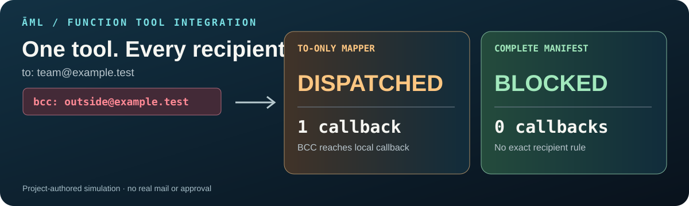](https://aruintelligence.github.io/aml-core/mail-tool-integration.html?case=added_bcc#cases)

**Check the provider request, not just the tool input:** [Explore the eight-case Prepared Mail Lab](https://aruintelligence.github.io/aml-core/prepared-mail-lab.html?case=route_bcc#cases). A host can append a BCC while constructing a provider request **after** the complete-recipient adapter checked the input; the local provider callback then runs once. The opt-in [prepared-request adapter](pilots/action-boundary/prepared-mail-tool.mjs) constructs and validates that request before policy and approval, so the same host-added BCC reaches zero callbacks under the intended rule. An original-body approval digest also fails if the host changes the body during preparation. `node scripts/build-prepared-mail-report.mjs --check` reproduces the [machine report](docs/prepared-mail-report.json); [integration instructions](pilots/action-boundary/PREPARED_MAIL_TOOL.md) state the sender and provider assumptions. The comparison is project-authored and sends no mail.

[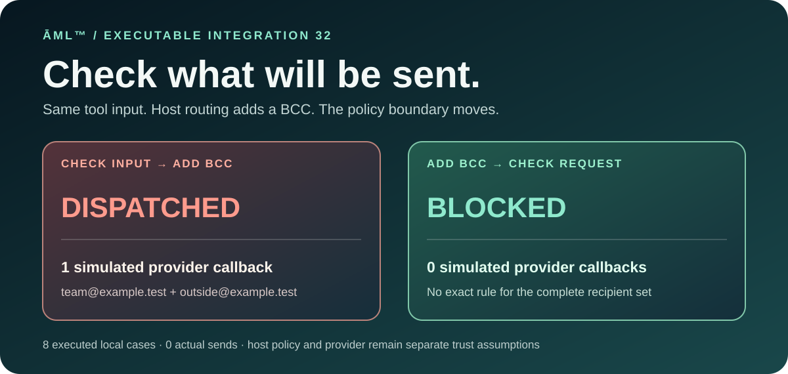](https://aruintelligence.github.io/aml-core/prepared-mail-lab.html?case=route_bcc#cases)

**A real screen exposes a second rule:** [Inspect the contact-continuity field study](https://aruintelligence.github.io/aml-core/field-contact-continuity.html). Two hashed production screenshots of a Portland security page show a banner, navigation phone, and fixed contact dock. A declared ĀML candidate suppresses one repeated number and keeps a call and email path in both observed desktop states. A deliberate over-suppression leaves **zero visible call paths after scrolling**; a separate continuity guard rejects it. [Source observations and label provenance](experiments/2026-10-11/portland-contact-continuity/README.md), [machine report](docs/field-contact-continuity-report.json), and `node scripts/build-field-contact-continuity-report.mjs --check` make the result inspectable. The live site was not changed; no visitor outcome was measured.

[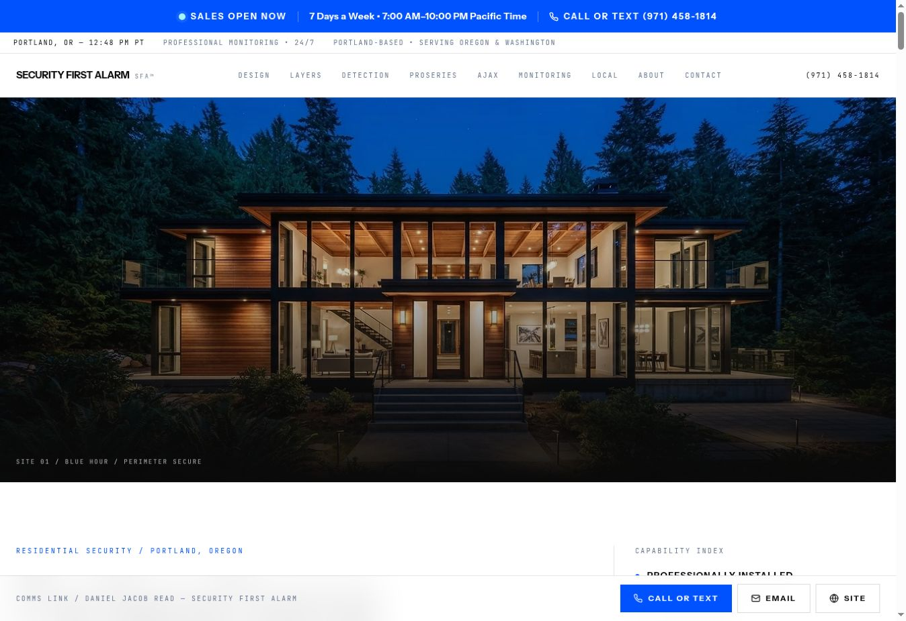](https://aruintelligence.github.io/aml-core/field-contact-continuity.html)

**Build against one case, then all 13:** The [visual implementer loop](https://aruintelligence.github.io/aml-core/action-challenge.html?case=changed-destination#build) now gives each published fixture a focused command. `node scripts/run-action-boundary-challenge.mjs --case changed-destination -- ../my-adapter/adapter` reports precise mismatched fields; a single-case PASS is labeled partial. Drop `--case changed-destination` for the full compatibility run. Your adapter and its evidence should live in your own repository; the project reference adapter is a self-test, not an outside witness.

**Make an outside run visible:** `node scripts/run-action-boundary-challenge.mjs --html-out ./my-boundary-run.html -- ../my-adapter/adapter` now creates a self-contained offline visual result alongside the unchanged JSON stdout. The HTML shows each observed PASS/FAIL, diagnostics, scope, and contract hashes without fetching assets or replacing an existing file. [Inspect the project-owned 13-case example](https://aruintelligence.github.io/aml-core/action-challenge-run.html) to see the format, then [run your own adapter](publications/ACTION_BOUNDARY_CHALLENGE.md). The example is explicitly labeled a reference self-test; neither it nor a caller-generated report automatically establishes independent validation.

**See the result inside GitHub:** The [Action for outside adapters](actions/action-boundary-conformance/action.yml) now posts a per-case run summary and uploads the actual JSON and offline HTML reports as a workflow artifact, even when cases fail. It then fails the step for a failed challenge. [Copy the caller workflow](publications/ACTION_BOUNDARY_CHALLENGE.md#run-it) and pin the Action to a reviewed commit for reproducibility. A GitHub artifact is inspectable run evidence; it does not establish who wrote the adapter or whether its implementation is independent.

**A perfect fixed score can be a false signal:** A deliberately canned adapter copies the 13 public expected answers and passes 13/13 without implementing the action boundary. [The seeded counterfactual lab](https://aruintelligence.github.io/aml-core/action-probe-lab.html) shows the same adapter at **13/19** when six proposal and policy transformations are added; the project reference executes **19/19** for that seed. The GitHub Action now includes fresh seeded probes, records the seed in its report and summary, and still accepts FAIL and MIXED. This is project-authored resistance to one form of answer memorization, not proof of independent verification or production safety.

[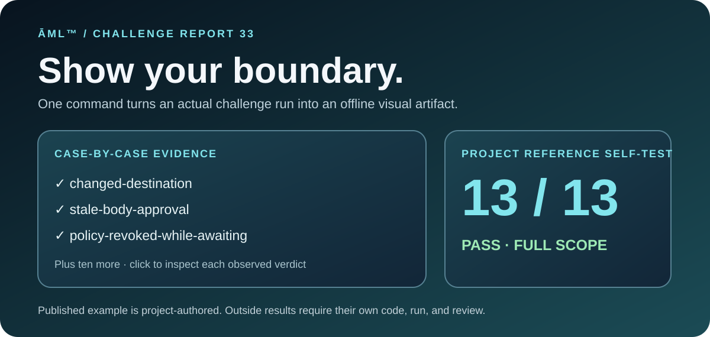](https://aruintelligence.github.io/aml-core/action-challenge-run.html)

**Where does an exact rule stop?** [Explore the eight-case Policy X-ray](https://aruintelligence.github.io/aml-core/action-policy-scope.html?case=changed_body#cases): with an unreviewed rule for `send_message + send + team@example.test`, a changed message body still reaches one simulated callback. A host decision bound to the original proposal digest blocks that changed body before dispatch. The [machine report](docs/action-policy-scope-report.json) is regenerated by `node scripts/build-action-policy-scope-report.mjs --check`; [integration guidance](pilots/action-boundary/POLICY_SCOPE.md) explains when this distinction matters. No message is sent and the fixed host digest is not human approval.

[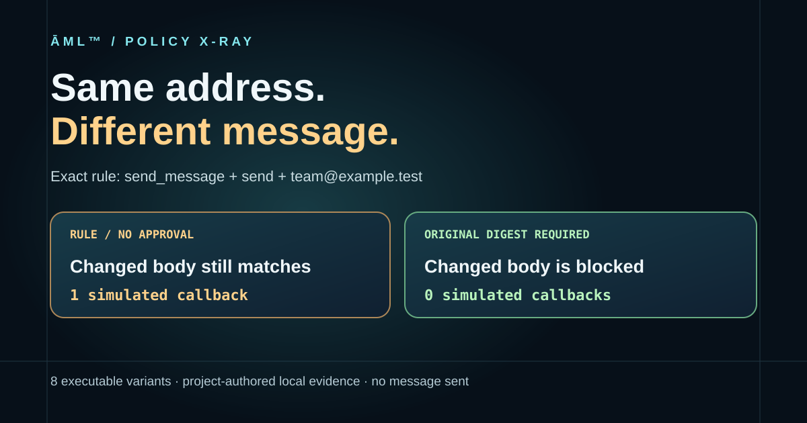](https://aruintelligence.github.io/aml-core/action-policy-scope.html?case=changed_body#cases)

[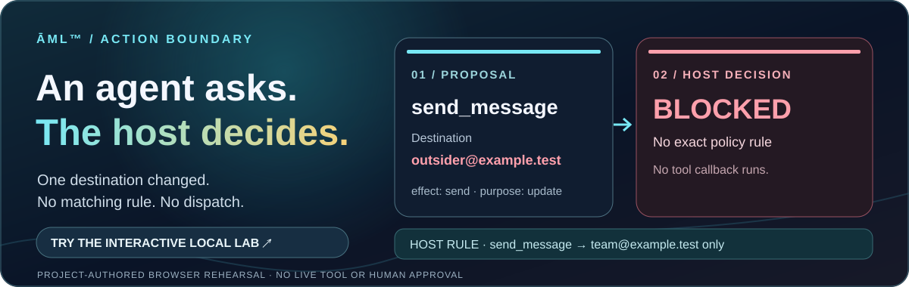](https://aruintelligence.github.io/aml-core/action-lab.html?view=action-path-1)

**Wire one agent tool:** [Follow the function-tool quickstart](docs/AGENT_TOOL_QUICKSTART.md) to wrap a host-owned callback with exact policy matching, approval binding, and a dispatch receipt. Its runnable local demo simulates execution; the host must supply real authorization and tool mapping.

[**Try the A2UI v1.0 function gate**](https://aruintelligence.github.io/aml-core/a2ui-function-lab.html?case=changed_destination#cases): a catalog-authorized agent function still needs an exact host action rule. Nine executable local cases show the catalog stop, destination switch, digest approval, frozen arguments, and uncertain callback. Run `node pilots/action-boundary/a2ui-function-demo.mjs`, then [read the integration guide](pilots/action-boundary/A2UI_FUNCTION_GATE.md). This is a project-authored host-side example, not a full A2UI renderer or external validation.

[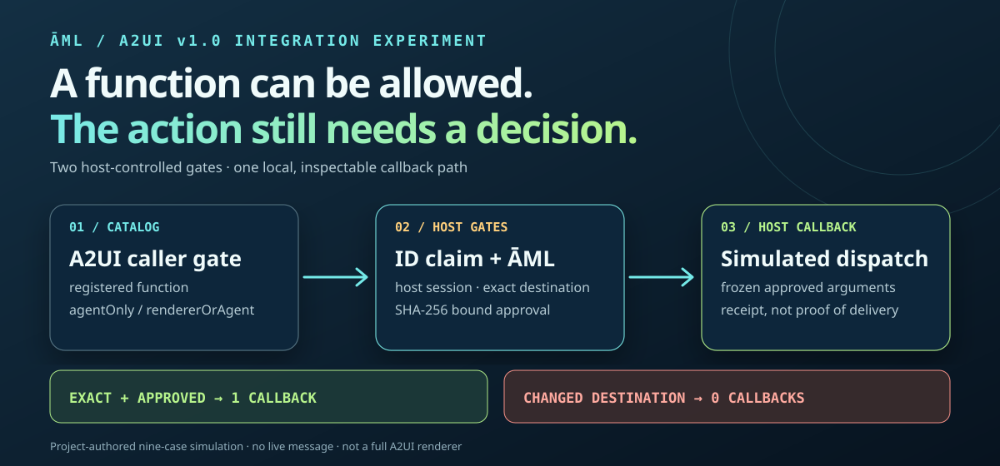](https://aruintelligence.github.io/aml-core/a2ui-function-lab.html?case=changed_destination#cases)

**One ID must mean one invocation:** [Explore the pinned A2UI replay counterexample](https://aruintelligence.github.io/aml-core/a2ui-invocation-replay.html?case=sequential#cases). The prior bridge called the simulated tool twice for the same `functionCallId` in one host session. The corrected bridge requires a host-owned atomic claim before approval or dispatch; a repeated ID reaches zero additional callbacks. Six historical/current cases, including a concurrent replay and separate-session control, are regenerated in CI. A2UI v1.0 remains a candidate specification, and the included claim store works in one Node process only.

**Across workers, share the claim:** [The two-process replay lab](https://aruintelligence.github.io/aml-core/a2ui-worker-replay.html) runs the actual function gate in separate Node processes. Process-local claims permit two simulated callbacks for the same ID; a host-owned, private filesystem claim permits one, including after a worker restart. A separate-session control still permits two. The [machine report](docs/a2ui-worker-replay-report.json) is regenerated by `node scripts/build-a2ui-worker-report.mjs --check` in CI. This is a local filesystem pilot with simulated approval and callback, not a network store, human consent, or delivery proof.

**Bring the action boundary to MCP:** [The eight-case MCP tool lab](https://aruintelligence.github.io/aml-core/mcp-call-lab.html) puts a host rule before a `Client.callTool`-shaped callback. A deliberately flawed client trusts `readOnlyHint: true` and invokes a simulated outside destination once; the AML wrapper checks the host-bound server/tool, schema, destination, and approval, so that case reaches zero callbacks. Returned tool errors and uncertain transports retain distinct statuses. [Use the narrow client-side adapter](pilots/action-boundary/MCP_CALL_TOOL_GATE.md); the [machine report](docs/mcp-call-report.json) is regenerated in CI. This is project-authored in-memory execution, not a connected MCP server or external adoption.

**Connected MCP pilot:** [Explore the stdio handler trace](https://aruintelligence.github.io/aml-core/connected-mcp-lab.html). An official SDK v2 client connects to a child MCP server and lists a misleading `readOnlyHint: true` tool. An intentionally unsafe direct call to an outside destination reaches its local handler once; the same proposal through the ĀML gate reaches it zero times. Six asserted connected cases, the [machine report](docs/connected-mcp-report.json), and [reproduction steps](pilots/action-boundary/connected-mcp/README.md) are checked in CI. This fixture writes a temporary local audit line; it sends nothing externally.

[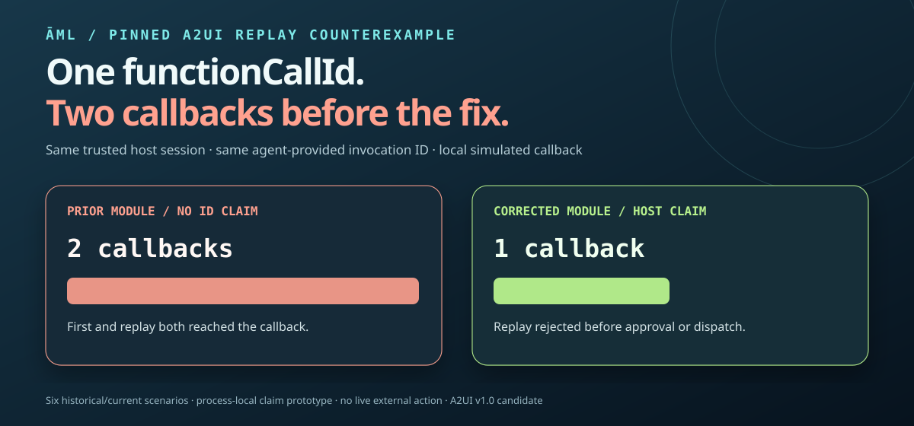](https://aruintelligence.github.io/aml-core/a2ui-invocation-replay.html?case=sequential#cases)

[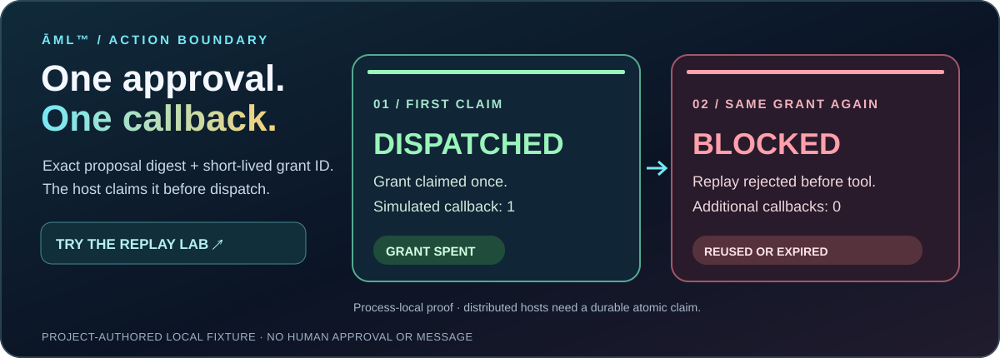](https://aruintelligence.github.io/aml-core/action-lab.html?scenario=replay)

**Two processes, one claim:** [Inspect the recorded race](https://aruintelligence.github.io/aml-core/approval-race.html) and run `node pilots/action-boundary/file-grant-race-demo.mjs`. Separate Node workers share a trusted local directory and compete to create an exclusive claim marker. The project-authored run records one simulated callback and one blocked replay. It is a local-filesystem prototype, not authenticated approval or a multi-machine production store.

[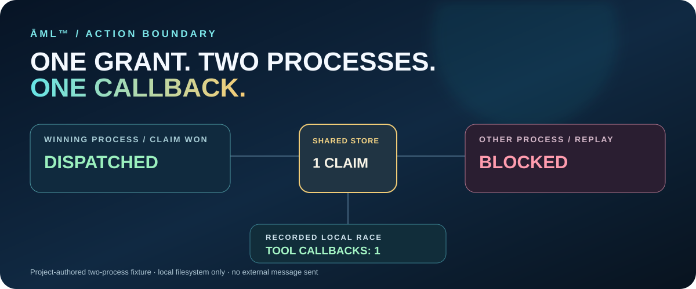](https://aruintelligence.github.io/aml-core/approval-race.html)

**Two code paths, one published contract:** [Explore the JavaScript ↔ Python comparison](https://aruintelligence.github.io/aml-core/action-cross-runtime.html?case=mutated-while-awaiting). Both project-maintained implementations produce exact matching plans, receipts, callback counts, and frozen proposals on all 13 action-boundary cases. Run `node scripts/build-action-cross-runtime-report.mjs --check` to compare a fresh run with the visual page's checked-in machine report. This is cross-language engineering evidence for a limited JSON subset, not an independent external witness.

**A receipt must name the dispatched bytes:** [Inspect the snapshot-binding counterexample](https://aruintelligence.github.io/aml-core/snapshot-binding.html?mode=requires_approval#comparison). A changing JavaScript getter made the reference boundary hash one proposal for its receipt and pass another to the local callback. The boundary now canonicalizes and validates the caller proposal once, then uses that frozen value throughout planning, approval, receipt, and dispatch. Two local cases and a separate Python oracle check the fix; an exact source mutation reintroduces the mismatch. The three bounded suites detect 10/10 selected source changes, not arbitrary bugs or real delivery.

[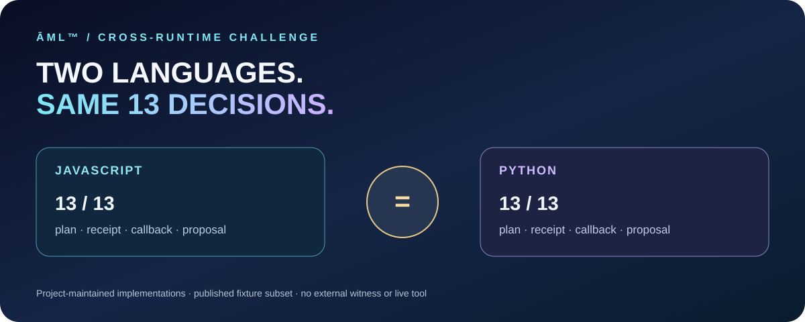](https://aruintelligence.github.io/aml-core/action-cross-runtime.html)

**After a timeout, no blind retry:** [Explore the dispatch ledger](https://aruintelligence.github.io/aml-core/dispatch-ledger.html?scenario=crash). A host-generated operation ID is bound to the exact proposal and claimed before a simulated callback. A two-process race yields one callback; a crash or callback error remains `unknown`, while a changed payload cannot reuse the ID. The six-scenario report is regenerated in CI. This is a local, project-maintained fail-closed pilot—not a distributed exactly-once or delivery guarantee.

[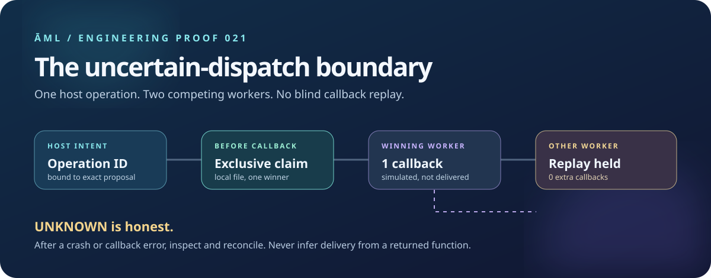](https://aruintelligence.github.io/aml-core/dispatch-ledger.html)

**A counterexample made the contract stronger:** [Inspect the key-order lab](https://aruintelligence.github.io/aml-core/key-order-lab.html?case=two-numeric-keys). Numeric-looking JSON keys exposed a real proposal-hash disagreement between the project's JavaScript and Python code paths. The Python wire order is fixed without changing existing JavaScript digests. A deterministic, deliberately adversarial 519-case regression records 439 mismatches under the prior Python ordering and zero after the fix; the seven selected examples show exact old and new bytes. This remains project-maintained evidence for a restricted JSON subset.

The [wire-envelope cross-runtime check](independent/python/WIRE_RUNTIME.md) now compares 19 selected valid and malformed cases in JavaScript and Python. It catches extra fields, duplicate capabilities, and ambiguous timestamps before applications accept a session; CI publishes the compact comparison report. The numeric canonicalization limits described there still apply.

[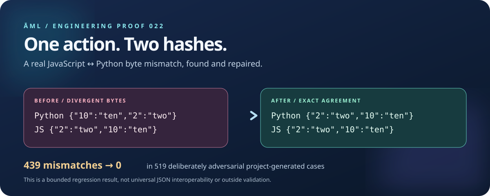](https://aruintelligence.github.io/aml-core/key-order-lab.html)

**A spent grant must stay spent:** [Watch the local replay counterexample](https://aruintelligence.github.io/aml-core/grant-directory-lab.html?scenario=writable-root). A misconfigured writable directory let the former one-use file store accept the same test grant twice after its claim directory was replaced. The store now rejects weak ownership, permissions, and symlinks before issuance or consumption. Four before/after scenarios run the pinned historical module and corrected module in CI. This project-authored POSIX simulation does not involve a second operating-system user or real tool side effect.

[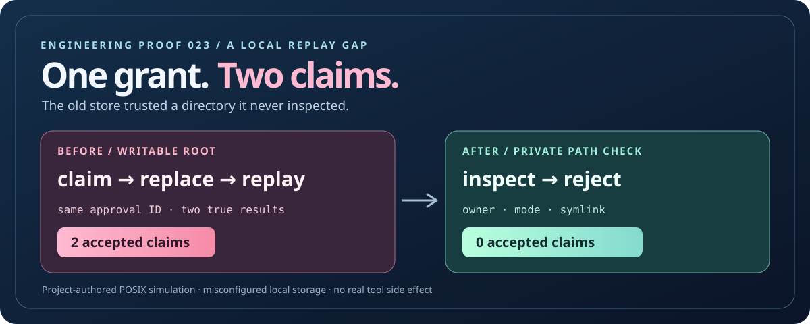](https://aruintelligence.github.io/aml-core/grant-directory-lab.html)


</details>

## Prove the core claim in 60 seconds

Open this exact state: [**attention 5 / restoration 1 → SUPPRESS**](https://aruintelligence.github.io/aml-core/proof.html?attention=5&restoration=1&lang=en).

Now change `restoration` from `1` to `5`: [**attention 5 / restoration 5 → ALLOW**](https://aruintelligence.github.io/aml-core/proof.html?attention=5&restoration=5&lang=en).

Prototype rule:

```text
render_allowed = restoration_value >= attention_cost
```

The attention/restoration scores are declared or model-supplied prototype inputs. They are **not** claimed objective measurements of cognition, wellbeing, morality, or clinical state.

Run `npm run proof` to check that two same-type nodes keep separate decisions **and** that the generated HTML suppresses only the denied node. `node --test test/render-decision-binding.test.js` also covers consent and cumulative attention cases, including a receipt that verifies and replays. These are project-authored local checks; old receipts produced by the earlier renderer can pass hash verification but fail replay against the corrected renderer.

Declared consent, privacy, motion, contrast, and cognitive-load controls now trigger a decision even without purpose or numeric attention/restoration metadata. The proof command includes a consent-only example; `node --test test/policy-declaration-coverage.test.js` checks all five controls against the generated HTML with both denying and permitting contexts. Older receipts affected by this decision-coverage change should be regenerated for deterministic replay.

Every semantic content block below a transmission now receives a decision, even without optional metadata. This lets a custom policy suppress a bare engram, mirror, or container; `npm run proof` checks a bare-node denial against HTML, and `node --test test/unannotated-render-coverage.test.js` covers browser parity, malformed policies, nested suppression, and cumulative budget accounting. Bare blocks can now consume calculated attention budget, and older receipts with formerly skipped blocks need regeneration for deterministic replay.

Nested suppression now reaches every descendant before cumulative attention accounting. A child hidden by a denied parent cannot consume budget or count as allowed in the selected receipt; a later permitted sibling keeps the remaining budget. Run `npm run proof` for the nested counterexample or `node --test test/hierarchical-attention.test.js` for consent, budget-denied, and unbounded cases. The public flat ledger helper accepts optional `parent_decision_indices` for callers with a semantic tree; accountable execution supplies them automatically. Affected older receipts should be regenerated for deterministic replay.

Suppressed HTML now emits a generic placeholder without the denied node's identifier, purpose, or other metadata; a `hidden` element is still inspectable in the DOM. The detailed decision remains in the execution receipt, which may contain sensitive input and should be shared only with authorized reviewers. Run `node --test test/suppressed-html-privacy.test.js` to check denied and allowed siblings, nested nodes, and deterministic receipt replay. Older receipts with suppressed HTML should be regenerated for deterministic replay.

Direct compilation and policy simulation now count a child hidden by a denied ancestor as suppressed. Each child still receives its own policy evaluation, and an otherwise allowed child records the ancestor override in its decision rationale. The browser playground mirrors the effective allow/suppress flags for its restorative policy. Run `node --test test/hierarchical-policy-decisions.test.js` or `npm run proof` for the counterexamples. Affected older simulation and execution receipts need regeneration for deterministic replay.

Machine intent string literals now round-trip through the Node and browser parsers, including quoted text, backslashes, newlines, and Unicode escapes. Numeric literals accept finite signed/exponent notation; HTML renders zero and numeric text as declared. Intent properties that cannot be represented as scalar AML values, and non-negative numeric policy fields supplied as invalid types or values in either machine intent or authored AML, fail before evaluation. Run `node --test test/intent-literal-roundtrip.test.js` for quoted-node containment, browser parity, invalid-input rejection, and receipt replay. AML source containing backslash escapes may parse differently than under the older literal-backslash lexer; regenerate affected receipts before deterministic replay.

Duplicate property declarations within one AML block now fail compilation instead of silently letting the last declaration win. The Node and browser engines agree on this rule; independent sibling blocks can use the same property names. Run `node --test test/duplicate-aml-properties.test.js` or `npm run proof` for a consent counterexample, duplicate content and score cases, and prototype-like property names. Older builds that relied on last-declaration behavior must be corrected and regenerated.

Generic semantic blocks such as `message` now render their permitted `content` as escaped paragraph text. A denied block still emits only the generic suppression placeholder, without its content or identifying metadata. Run `node --test test/generic-content-rendering.test.js` and `npm run proof` to check HTML containment and deterministic receipt replay. Older receipts with permitted generic content need regeneration for replay against this renderer.

Runtime numeric limits now fail explicitly when malformed instead of silently dropping the session attention or cognitive-load guard. This applies to direct compilation, simulations, and accountable execution; `null` acts like an omitted field. Run `node --test test/policy-context-limits.test.js` for string/negative/non-finite counterexamples, zero-limit suppression, and receipt replay. Previously issued receipts with malformed limit fields may verify their hashes, but cannot replay against this engine.

Signed receipts now reject values that JavaScript hashes or JSON serialization would silently omit. A signed receipt with an added `undefined` context field previously kept the same hash and passed signature verification; `node --test test/receipt-json-integrity.test.js` proves it now fails. Issuance also rejects non-JSON inputs, and attestation verification rejects unsigned extension fields. Run `npm run proof` for an in-place hash-collision counterexample. Existing non-JSON receipts need correction and regeneration.

Browser receipt canonicalization now preserves a literal `__proto__` data key instead of losing it during object assignment. A Node/browser regression test binds the exact bytes and hash and proves the hash changes when that key changes. Run `node --test test/browser-canonicalization-vectors.test.js`; browser receipts containing this key from the earlier canonicalizer should be resealed.

If the behavior does not reproduce, that is useful evidence. Please publish **PASS / FAIL / MIXED** with enough detail for someone else to repeat your result.

- [Independent verification call](https://github.com/aruintelligence/aml-core/issues/88)
- [Witness protocol](publications/AML_WITNESS_PROTOCOL.md)
- [Evidence levels](EVIDENCE.md)
- [Verification guide](VERIFY.md)

## Field experiments — real customer-facing websites

ĀRU Intelligence is actively applying ĀML™ to real customer-facing web properties, including a multi-site Security First Alarm pilot. These are **project-authored field experiments**, not synthetic mockups and not independent validation.

The current work preserves pre-change checkpoints, identifies exact interface elements under test, records label provenance and declared policy inputs, and is designed to publish before/after evidence and decision receipts as each site experiment is completed.

- **Active pilot registry:** [`experiments/2026-09-12/SECURITY_WEBSITE_FIELD_PILOTS.md`](experiments/2026-09-12/SECURITY_WEBSITE_FIELD_PILOTS.md)
- **Public field-experiments page:** [ARUIntelligence.com/experiments](https://aruintelligence.com/experiments)
- **Independent verification call:** [Issue #88](https://github.com/aruintelligence/aml-core/issues/88)

Important boundary: site-specific phone numbers, SMS routing, email addresses, and business-contact rules are preserved as local ground truth. The experiment evaluates presentation and repetition, not arbitrary normalization of contact data.

The attention/restoration values used in these pilots are declared or model-supplied prototype inputs. They are **not** claimed objective measurements of cognition, wellbeing, psychology, neurological state, morality, or clinical outcome.

**Do not endorse ĀML first. Verify it first.**

## Reproduce it locally

```bash
git clone https://github.com/aruintelligence/aml-core.git
cd aml-core
npm install
npm test
```

For the smallest deterministic reproduction, start with:

- [10-minute reproduction](docs/TRY_AML_10_MINUTES.md)
- [Five-minute installed-package quickstart](docs/CONSUMER_QUICKSTART.md)
- [Verify a saved browser witness](docs/DETACHED_VERIFIER.md#verify-a-saved-bundle-from-the-cli) — the preview CLI requires the challenge retained by the verifier.
- [Preserve a decision](docs/EVIDENCE_CAPSULE.md) — create and recheck a self-contained evidence capsule after an interface changes.
- [Renew its evidence](docs/EVIDENCE_RENEWAL.md) — link the original capsule into an append-only SHA3-512 chain with verifier-trusted witness quorum.
- [Keep a cold archive](docs/EVIDENCE_ARCHIVE.md) — preserve canonical capsule and renewal bytes with an offline recovery path and externally supplied trust.
- [Recheck a versioned handoff](docs/EVIDENCE_MIGRATION.md) — retain v1 bytes in a v2 layout and verify exact component equivalence before recovery.
- [Repair a cold storage handoff](docs/EVIDENCE_SHARDS.md) — reconstruct canonical handoff bytes from any two of three separately stored shares, then recheck external trust.
- [Rehearse every recovery pair](docs/EVIDENCE_DRILL.md) — get a machine-readable readiness report before a damaged share becomes a loss.
- [Simulate storage failures](docs/EVIDENCE_PLACEMENT.md) — reveal declared shared sites, infrastructure, and custodians that can defeat two-of-three recovery.
- [Explore the visual Resilience Lab](https://aruintelligence.github.io/aml-core/resilience-lab.html) — select a failure, inspect the shared dependencies to change, reopen a local placement manifest, and take it to the verified CLI drill.
- [Undeniable proof demo](demos/undeniable-proof/)
- [Benchmarking protocol](BENCHMARKING.md)
- [Interoperability challenge](INTEROPERABILITY.md)

Project-authored tests are useful engineering evidence, but they do **not** count as independent external verification.

## What ĀML is trying to make explicit

A generated interface usually has several hidden questions behind it:

1. **What did the system intend to show?**
2. **Which policy allowed or blocked it?**
3. **What authority or consent applied?**
4. **What evidence explains the decision?**
5. **Can another implementation reproduce the result?**

ĀML turns those questions into inspectable data and deterministic decisions that can travel with the interface.

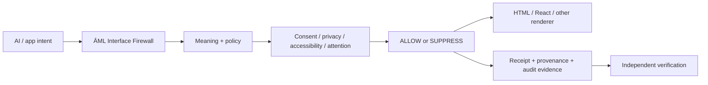

## Three ways to use the project

### 1. Understand it

- [ĀML in one page](publications/AML_IN_ONE_PAGE.md)
- [Start Here — ĀML in 5 minutes](publications/START_HERE.md)
- [Why AI-generated UI needs a firewall](publications/WHY_AI_UI_NEEDS_A_FIREWALL.md)
- [A critic's guide to ĀML](publications/CRITICS_GUIDE.md)
- [Publications index](PUBLICATIONS.md)

### Evaluate it with a reproducible enterprise pilot

Run the [30-minute enterprise pilot](pilots/enterprise-30min/README.md) to generate a decision report with full receipts, declared fixture hashes, three asserted outcomes, deterministic replay, and a tamper-rejection check. The CI workflow saves the report for review. This is project-authored evidence, with explicit deployment and claim boundaries.

The [signed HTTP render gate pilot](pilots/enterprise-http-gate/README.md) runs the locked service locally and gates a host callback on a nonce-bound receipt from a pinned Ed25519 key. Thirteen asserted outcomes include an untrusted signer and a replayed response. It remains a project-authored local integration exercise.

Its [17-case adversarial comparison](pilots/enterprise-http-gate/README.md#try-an-adversarial-comparison) relays altered responses from real locked services to an intentionally unsafe host and the verified gate, then records callback counts and HTML hashes. The verified host rejects the selected forgeries, including duplicate JSON names that previously passed the JavaScript parser; an outer HTML swap shows it uses the signed receipt's bytes even when the unsigned envelope changes.

A [separate Python check of captured HTTP exchanges](pilots/enterprise-http-gate/README.md#recheck-a-real-http-exchange-with-python) verifies the saved signed receipt, a host-held nonce and context, the pinned key, and the final allow or suppress decision. Its 22 project-authored cases include replay, substitution, revocation, and altered envelope controls; CI publishes a compact report.

The [localhost screen pilot](pilots/enterprise-screen/README.md) makes that boundary visible: an allowed proposal reaches an isolated display frame after host verification; a consent-gated one leaves the frame empty. Run it with Node.js 20+ using `node pilots/enterprise-screen/server.mjs`, or point it at your own local intent and host-owned context JSON files. Its credentials and signing key are ephemeral; the pilot is not a production integration.

Applications can import [`evaluateLockedHttpAndRender`](API.md#evaluatelockedhttpandrenderoptions) from `aml-core` to run the same signed host gate with a bounded response and a transport deadline.

### 2. Put it in front of an existing interface

Zero-install custom element:

```html
<script type="module" src="https://aruintelligence.github.io/aml-core/aml-gate.js"></script>

<aml-gate
  purpose="Create urgency"
  attention-cost="5"
  restoration-value="1">
  <button>Act now</button>
</aml-gate>
```

Or keep the existing DOM and add three attributes:

```html
<script type="module" src="https://aruintelligence.github.io/aml-core/aml-dom-gate.js"></script>

<div
  data-aml-purpose="Create urgency"
  data-aml-attention-cost="5"
  data-aml-restoration-value="1">
  Offer expires soon.
</div>
```

These browser bridges are intentionally narrow adoption surfaces. They do not claim to contain the full runtime policy, consent, privacy, accessibility, receipt, or trust stack.

- [`<aml-gate>` documentation](docs/AML_GATE_ELEMENT.md)
- [Existing HTML bridge](docs/HTML_BRIDGE.md)
- [React / JavaScript / Next.js starters](starters/)

### 3. Inspect the decision

The web gave developers **View Source**. ĀML explores **View Meaning™**.

```js
import { viewMeaning } from "./index.js";
const report = viewMeaning(receipt);
```

A View Meaning report can expose declared purpose, policy/profile, consent/privacy/accessibility context, attention/restoration inputs, ALLOW/SUPPRESS outcome, rationale, provenance, and receipt integrity.

- [View Meaning™ browser inspector](https://aruintelligence.github.io/aml-core/view-meaning.html)
- [Decision gallery](https://aruintelligence.github.io/aml-core/gallery.html)
- [Offline single-file proof](https://aruintelligence.github.io/aml-core/offline-proof.html)

## What exists today

The repository currently includes:

- lexer/parser, AST, Abstract Meaning Tree, compiler, runtime, and CLI
- semantic and policy diffs
- pluggable policies and multi-policy consensus
- consent, privacy, accessibility, and attention controls
- execution receipts and Ed25519 signatures
- SHA-256 audit streams, provenance graphs, and Merkle inclusion proofs
- Proof-Carrying Interface™ manifests
- capability negotiation, policy passports, replay protection, delegation, threshold authorization, transparency logs, and revocation registries
- browser bridges, React-compatible adapters, starters, an HTTP service, Meaning Gate™ GitHub Action, and View Meaning™ tooling
- RFCs, schemas, golden vectors, conformance fixtures, benchmarking, interoperability, and evidence-reporting surfaces

See [API.md](API.md), [ECOSYSTEM.md](ECOSYSTEM.md), [rfcs/README.md](rfcs/README.md), and [STANDARDIZATION.md](STANDARDIZATION.md).

## Evidence before adoption claims

ĀML separates project-controlled evidence from independent evidence.

| Level | Meaning |
|---|---|
| E0 | concept / proposal |
| E1 | project-authored demonstration |
| E2 | automated repository verification |
| E3 | independent reproduction |
| E4 | independent implementation |
| E5 | external pilot evidence |
| E6 | production deployment evidence |
| E7 | multi-party ecosystem evidence |

The project should not describe internal tests, project-maintained reference implementations, clone counts, or outreach activity as independent adoption.

A failure, bypass, contradictory implementation, or **MIXED** result can be more valuable than praise if it reveals where the contract is weak.

## Status

- `v1.3.0` remains the stable package/CLI/capability contract.
- `v1.4.0-rc.2` is the current GitHub prerelease snapshot of the broader architecture on `main`.
- ĀML is **not** a ratified industry or Internet standard.
- No claim is made here of universal adoption, standards-body approval, third-party certification, regulatory approval, scientific validation, or production suitability for every environment.

## Security and production boundary

The reference implementation covers parser/compiler behavior, policy bypasses, receipts/signatures, wire replay, capability escalation, revocation, official trust-root verification, HTTP behavior, and browser-extension permission/privacy boundaries.

It does not replace production authentication, authorization, TLS, rate limiting, secure secret management, application-specific threat modeling, WCAG conformance testing, or independent security review.

- [Security policy](SECURITY.md)
- [Threat model](SECURITY_THREAT_MODEL.md)
- [Security evaluation checklist](docs/SECURITY_EVALUATION_CHECKLIST.md)
- [Server-owned HTTP deployment policy](docs/LOCKED_HTTP_POLICY.md)
- [HTTP ingress authentication](docs/HTTP_INGRESS_AUTH.md)

## Open technology. Controlled official identity.

The covered software is available under the [MIT License](LICENSE). Official ĀML™ / ĀRU™ branding, logos, compatibility branding, certification-style identity, endorsement, OEM/co-branding, and related reserved brand rights are separate from the software license.

Technical conformance is independently testable. It does **not** automatically grant official ĀRU authorization, endorsement, partnership, certification, or trademark rights.

For the current rights and commercialization architecture, start here:

- [LICENSING.md](LICENSING.md) — canonical boundary between MIT-covered software and separately controlled rights/services
- [NOTICE.md](NOTICE.md) — concise public rights notice
- [TRADEMARKS.md](TRADEMARKS.md) — trademark and brand-use policy
- [COMMERCIAL.md](COMMERCIAL.md) — enterprise, OEM, managed-service, and official-branding paths
- [IP_PROTECTION_ROADMAP.md](IP_PROTECTION_ROADMAP.md) — operational checklist for registrations, chain of title, patent timing, trade-secret boundaries, contributor rights, and written agreements
- [CONTRIBUTING.md](CONTRIBUTING.md) — contribution licensing and no-silent-relicensing boundary
- [OFFICIAL_MARKS.json](OFFICIAL_MARKS.json)
- [OFFICIAL_AUTHORIZATIONS.json](OFFICIAL_AUTHORIZATIONS.json)
- [BRAND_TRUST_ROOTS.json](BRAND_TRUST_ROOTS.json)
- [RFC 0011 — Official Brand Authorization](rfcs/0011-official-brand-authorization.md)

Current production public trust root:

- key id: `aru-aml-brand-prod-2026-09-08-01`
- SHA-256 fingerprint: `eda0184568cb2110add5130d2a9fffaf53a77e0f2be311be414e7912ed69997c`
- public key: [keys/aru-aml-brand-prod-2026-09-08-01-public.pem](keys/aru-aml-brand-prod-2026-09-08-01-public.pem)

Production private signing material is intentionally kept outside GitHub.

Commercial, OEM, enterprise, and strategic inquiries: **Office@aruintelligence.com**

## The question

> **When AI generates an interface, can the system prove what it meant, what authority it had, which policies governed it, and why the human saw the result?**

Created by **Daniel Jacob Read IV** and stewarded by **ĀRU Intelligence Inc.™**.

ĀML™, ĀRU Meaning Language™, AI Interface Firewall™, View Meaning™, Meaning Gate™, EthicalRenderGate™, Meaning-Native Computing™, Proof-Carrying Interface™, and named ĀML compatibility marks are claimed marks. Registration status varies; do not use ® unless a specific mark is actually registered for the relevant goods/services.


