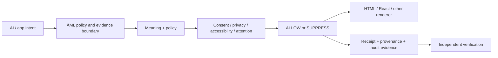

<div align="center">
  <a href="https://aruintelligence.github.io/aml-core/first-run.html"></a>
</div>

# ĀML™ — ĀRU Meaning Language™

[](https://github.com/aruintelligence/aml-core/actions/workflows/ci.yml)
[](https://aruintelligence.github.io/aml-core/proof.html?attention=5&restoration=1&lang=en)
[](https://github.com/aruintelligence/aml-core/releases/tag/v1.3.0)
[](https://github.com/aruintelligence/aml-core/releases/tag/v1.4.0-rc.2)
[](LICENSE)
[](SECURITY.md)

ĀML is an open-source **research prototype and reference implementation** for inspectable policy and evidence around AI-generated interfaces and host-owned agent actions. It can sit between machine intent and a human-facing surface so meaning, policy, authority, and evidence can be examined before and after a decision.

It is designed to work alongside existing HTML, React, and application stacks. It does not require teams to replace their frontend, and it does not replace production authentication, TLS, rate limiting, secret management, or an independent security review.

## Status

`v1.3.0` remains the stable package/CLI/capability contract. `v1.4.0-rc.2` is the current GitHub prerelease snapshot of the broader architecture on `main`.

This development line also contains later authorization-hardening work that is **not** a stable package release. Interfaces, schemas, and command exit semantics may still change. See [CHANGELOG.md](CHANGELOG.md) and [docs/COMMAND_AUTHORIZATION.md](docs/COMMAND_AUTHORIZATION.md).

Honest boundaries:

- ĀML is **not** a ratified industry or Internet standard.
- No claim is made here of universal adoption, standards-body approval, third-party certification, regulatory approval, scientific validation, or production suitability for every environment.
- Project-authored tests, labs, and pilots are engineering evidence. They are **not** independent validation, a completed audit, or a guarantee of safety or compliance.
- Attention and restoration values used in examples are declared or model-supplied inputs. They are **not** objective measurements of cognition, wellbeing, or clinical outcome.

## Quick start

```bash
git clone https://github.com/aruintelligence/aml-core.git
cd aml-core
npm install --ignore-scripts
npm test
```

Requires Node.js 20 or 24. Python 3 and Go are used by the independent verifier checks that CI also runs.

Further first steps:

- [Ten-minute reproduction](docs/TRY_AML_10_MINUTES.md)
- [Installed-package quickstart](docs/CONSUMER_QUICKSTART.md)
- [Interactive first run](https://aruintelligence.github.io/aml-core/first-run.html) — a project lab that does not dispatch a real tool
- [Documentation hub](docs/README.md)
- [Host-owned action-boundary reproduction](reproduction/action-boundary/REPRODUCE.md)

## Architecture

ĀML turns usually hidden questions — what the system intended, which policy applied, what authority was used, and what evidence remains — into inspectable data and deterministic decisions.



The repository currently includes a lexer, parser, compiler, runtime and CLI; policy evaluation and receipts; browser bridges and adapters; an HTTP evaluation service; schemas, RFCs, conformance fixtures; and JavaScript, Python, and Go verifier surfaces. See [ARCHITECTURE.md](ARCHITECTURE.md), [API.md](API.md), and [docs/README.md](docs/README.md).

## Try a browser gate

These browser bridges are narrow adoption surfaces. They do not contain the full runtime, consent, receipt, or trust stack.

```html
<script type="module" src="https://aruintelligence.github.io/aml-core/aml-gate.js"></script>

<aml-gate
  purpose="Create urgency"
  attention-cost="5"
  restoration-value="1">
  <button>Act now</button>
</aml-gate>
```

- [`<aml-gate>` documentation](docs/AML_GATE_ELEMENT.md)
- [Existing HTML bridge](docs/HTML_BRIDGE.md)
- [React / JavaScript / Next.js starters](starters/)
- [View Meaning inspector](https://aruintelligence.github.io/aml-core/view-meaning.html)

## Security model

The intended authorization rule is:

**No action should execute unless the complete authorization decision is explicitly true.** A valid signature, an accepted diagnostic, a satisfied quorum field, or an exit code of zero from a verification-only check must not be treated as permission by itself.

Where a command or API can authorize, the caller is expected to pin the values the decision depends on, such as an artifact digest, trusted key, policy digest, or revocation-registry digest. Diagnostic-only modes exist so a consistent result can be inspected without being treated as authorization.

This implementation still depends on the operator to protect trusted keys and pins, to treat a compromised host as outside the trust boundary, and to use application-level controls (TLS, authentication, rate limits, durable single-use storage) where they are required. A cryptographically valid signature proves key possession over a message; it is not, by itself, a trustworthy identity or an authorized action.

- [Security policy](SECURITY.md) — how to report a vulnerability
- [Threat model](SECURITY_THREAT_MODEL.md)
- [Security evaluation checklist](docs/SECURITY_EVALUATION_CHECKLIST.md)
- [Command authorization](docs/COMMAND_AUTHORIZATION.md)

## Evaluate and reproduce

Project-authored evaluations are useful, but they do not count as independent external verification. If a result does not reproduce, a **PASS / FAIL / MIXED** report with enough detail for someone else to repeat it is more valuable than praise.

- [Independent evaluation kit](AML_INDEPENDENT_EVALUATION_KIT.md)
- [30-minute enterprise pilot](pilots/enterprise-30min/README.md)
- [Independent verification call](https://github.com/aruintelligence/aml-core/issues/88)
- [Evidence levels](EVIDENCE.md)
- [Verification guide](VERIFY.md)

## Documentation and community

| Document | Purpose |
|---|---|
| [docs/README.md](docs/README.md) | Documentation index |
| [CONTRIBUTING.md](CONTRIBUTING.md) | How to build, test, and contribute |
| [CODE_OF_CONDUCT.md](CODE_OF_CONDUCT.md) | Contributor Covenant |
| [SUPPORT.md](SUPPORT.md) | How to get help |
| [GOVERNANCE.md](GOVERNANCE.md) | Project stewardship and RFC process |
| [CHANGELOG.md](CHANGELOG.md) | Version history |
| [SECURITY.md](SECURITY.md) | Vulnerability reporting |

## License and marks

The covered software is available under the [MIT License](LICENSE). Official ĀML / ĀRU branding, logos, compatibility marks, endorsement, and related reserved brand rights are separate from the software license. Technical conformance is independently testable and does **not** automatically grant official authorization, endorsement, partnership, certification, or trademark rights.

- [LICENSING.md](LICENSING.md)
- [NOTICE.md](NOTICE.md)
- [TRADEMARKS.md](TRADEMARKS.md)
- [COMMERCIAL.md](COMMERCIAL.md)

Commercial inquiries: **Office@aruintelligence.com**

Created by **Daniel Jacob Read IV** and stewarded by **ĀRU Intelligence Inc.™**.

ĀML™, ĀRU Meaning Language™, AI Interface Firewall™, View Meaning™, Meaning Gate™, EthicalRenderGate™, Meaning-Native Computing™, Proof-Carrying Interface™, and named ĀML compatibility marks are claimed marks. Registration status varies; do not use ® unless a specific mark is actually registered for the relevant goods/services.
